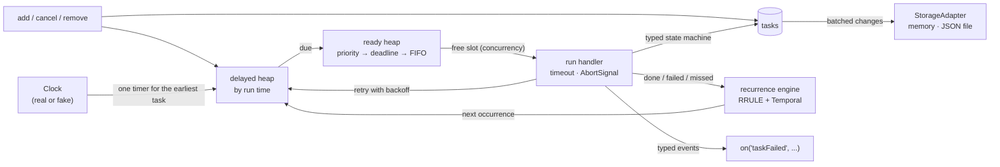

# ts-scheduler

**A fully typed TypeScript library and CLI that runs tasks by priority, deadline and iCalendar recurrence rules, with correct time-zone and daylight-saving handling.**

[](https://github.com/KALalev18/TS-Scheduler/actions/workflows/ci.yml)


[](LICENSE)


<sub>Recorded from real CLI output with <code>npm run demo</code>; the yellow notes are added by the script.</sub>



## The problem

Most "run this later" code in Node is `setInterval` plus hope. It breaks in ways that only show up in production:

- **Time zones and DST.** "Every day at 02:30 in Berlin" has no 02:30 on the spring-forward day and two of them in autumn. A job either silently skips, runs twice, or drifts an hour.
- **Priorities and deadlines.** When five jobs are due and only one can run, which goes first? What if a job waited so long it is no longer useful?
- **Failures.** Retries, timeouts, cancellation and "what happens to a job that was running when the process died" are usually missing.

ts-scheduler handles these explicitly, with documented rules and tests for each.

## Features

- **Binary-heap priority queue.** O(log n) insert and pop, stable for equal priorities. Due tasks are ordered by priority, then earliest deadline (EDF), then insertion order.
- **Recurrence.** A documented subset of [RFC 5545 RRULE](https://datatracker.ietf.org/doc/html/rfc5545#section-3.3.10): `MINUTELY`, `HOURLY`, `DAILY`, `WEEKLY`, `MONTHLY` with `INTERVAL`, `COUNT`, `UNTIL`, `BYDAY`, `BYMONTHDAY` (including `-1` for the last day), `BYHOUR` and `BYMINUTE`.
- **Time zones and DST,** built on the [Temporal API](https://tc39.es/proposal-temporal/docs/) (via `temporal-polyfill`). The rules are in [Design decisions](#time-zones-and-dst).
- **Typed task state machine:** `pending → running → done | failed | missed | cancelled`. Invalid transitions with literal states fail to compile; all others are rejected at runtime.
- **Failure handling:** retries with exponential backoff and full jitter, per-attempt timeouts, cancellation through `AbortSignal`, and a missed-deadline policy (`skip` or `run`).
- **Typed API.** Generic payloads per task type; `on('taskFailed', ...)` gets a typed event, and `task.type` narrows `task.payload`. No `any`.
- **Persistence.** A `StorageAdapter` interface with in-memory and JSON-file implementations. The file adapter writes atomically and validates loaded data with zod. Tasks survive restarts with at-least-once delivery.
- **Injectable clock.** `FakeClock` runs a week of schedules in milliseconds, which is how the test suite works.
- **CLI:** `ts-scheduler add | list | next | remove | run`, built on the public API.
- **Packaging:** ESM and CommonJS builds with type declarations. CI on Linux and Windows; release with Changesets and npm trusted publishing.

## Tech stack

TypeScript 6 (`strict`, `noUncheckedIndexedAccess`, `exactOptionalPropertyTypes`) · Node.js 22+ · Temporal (`temporal-polyfill`) · zod · commander · Vitest with v8 coverage · fast-check (property-based testing) · ESLint (`typescript-eslint` strict type-checked) · Prettier · tsup · TypeDoc · Changesets · GitHub Actions.

## Quick start

> Not on npm yet. The release workflow is ready; until the first release, install from source (below).

```bash
git clone https://github.com/KALalev18/TS-Scheduler.git
cd TS-Scheduler
npm ci
npm run build
node dist/cli.js --help
```

Requires Node.js 22.12 or newer (`.nvmrc` pins 22). The only configuration is the CLI's storage file. Copy `.env.example` or pass `--file`:

```bash
TS_SCHEDULER_FILE=./schedule.json   # default
```

### Library usage

```ts
import { JsonFileStorage, Scheduler } from '@kalalev18/ts-scheduler';

const scheduler = new Scheduler<{ report: { team: string } }>({
  storage: new JsonFileStorage('./schedule.json'),
  handlers: {
    report: async ({ payload, signal }) => {
      await fetch(`https://example.com/reports/${payload.team}`, { method: 'POST', signal });
    },
  },
});

await scheduler.add(
  'report',
  { team: 'data' },
  { rrule: 'FREQ=WEEKLY;BYDAY=MO;BYHOUR=9', timeZone: 'Europe/Helsinki' },
  { priority: 10, deadlineMs: 60_000, timeoutMs: 30_000, retry: { maxAttempts: 3 } },
);
scheduler.on('taskFailed', ({ task, error, willRetry }) =>
  console.warn(task.id, error.message, willRetry),
);
await scheduler.start();
```

Payload types can also be inferred from annotated handlers (`handlers: { email: (ctx: TaskContext<{ to: string }>) => ... }`). Payloads must be JSON, because they are stored.

### CLI usage

```bash
# Preview a rule without saving anything (note 03:30 on the DST day)
ts-scheduler next "FREQ=DAILY;BYHOUR=2;BYMINUTE=30" --tz Europe/Berlin --start 2027-03-26T00:00 -n 4

# Add tasks: one-off, recurring, with priority / deadline / timeout / retries
ts-scheduler add "nightly backup" --in 10s --priority 5
ts-scheduler add "standup" --rrule "FREQ=WEEKLY;BYDAY=MO,WE,FR;BYHOUR=9;BYMINUTE=30" --tz Europe/Helsinki
ts-scheduler add "flaky upload" --in 5s --retries 2 --fail-first 2 --backoff 500ms --jitter none

ts-scheduler list               # soonest first
ts-scheduler run                # Ctrl+C stops gracefully, a second Ctrl+C aborts running tasks
                                # (while it runs, add/remove on the same file are refused; list still works)
ts-scheduler remove 3e05        # unique id prefix
```

The CLI's only task type prints a message. `--fail-first` and `--work` simulate failures and slow work for demos. It never runs shell commands from the schedule file.

## Design decisions

### Two heaps instead of one sorted list

A scheduler answers two different questions, so it uses two binary heaps:

1. **"When do I next need to wake up?"** The _delayed_ heap is ordered by run time. Only its top matters, so the scheduler keeps **one** timer for the earliest task instead of one `setTimeout` per task.
2. **"Several tasks are due and one slot is free: which runs?"** The _ready_ heap is ordered by priority, then earliest deadline, then insertion order.

A heap gives O(log n) push and pop. A sorted array has O(1) pop but O(n) insert. With 100k items the heap was **10.5× faster** in the fill-then-drain benchmark. At a steady 10k items the gap shrinks to about 1.1–1.6× between runs, because V8's `splice` is a fast memory move at that size (see [Benchmarks](#benchmarks)).

A plain binary heap is **not stable**. Each entry carries an insertion sequence number as the final tie-breaker, so equal-priority tasks run first-in, first-out. Property tests check this against `Array.prototype.sort`, which is stable.

Cancelling or rescheduling a task does not search the heap. Each task has a `token` that is bumped on every change. Heap entries with an old token are skipped when popped (lazy deletion), so every operation stays O(log n).

### Time zones and DST

| Situation                                                                               | Behaviour                                                                                                                   |
| --------------------------------------------------------------------------------------- | --------------------------------------------------------------------------------------------------------------------------- |
| `DAILY` / `WEEKLY` / `MONTHLY`                                                          | Follow wall-clock time: 09:00 stays 09:00 local time across DST.                                                            |
| Wall-clock time in a spring-forward gap (02:30 in Berlin on 28 Mar 2027)                | Runs at **03:30**, shifted forward by the gap. This matches RFC 5545 and Temporal's `'compatible'` disambiguation.          |
| Wall-clock time that happens twice (02:30 on 31 Oct 2027)                               | Runs **once**, at the first 02:30 (`+02:00`).                                                                               |
| Two rule times collapse onto the same instant (`BYHOUR=2,3;BYMINUTE=30` on the gap day) | Runs once; occurrences are strictly increasing.                                                                             |
| `MINUTELY` / `HOURLY`                                                                   | Step in exact elapsed time from the start, so "every hour" is always 60 minutes apart and DST never skips or doubles a run. |
| `BYMONTHDAY=31` in a 30-day month                                                       | Skipped, as RFC 5545 specifies; use `-1` for "last day of the month".                                                       |

The recurrence engine jumps straight to the period containing "now" instead of walking from the start date. A **property test compares it with an independent day-by-day reference implementation** across seven time zones, including `America/Santiago` (DST changes at midnight) and `Australia/Lord_Howe` (30-minute DST shift).

### Deadlines and the missed-deadline policy

`deadlineMs` means _the occurrence must start within this long of its scheduled time_. Among equal priorities it orders the ready queue (earliest deadline first). When a slot frees up after the deadline has passed, `onMissed` decides what happens:

- `'skip'` (default): the occurrence becomes `missed`, a `taskMissed` event fires, and a recurring task moves on to its next occurrence;
- `'run'`: it runs late, and `taskMissed` still fires so you can alert on it.

Occurrences that passed while the process was down are **coalesced**: a daily task down for three days runs once on restart, not three times.

### Failure semantics

- **Retries** use `min(maxDelay, base · 2^(attempt−1))` with **full jitter** (a random delay between 0 and that value), so many tasks failing together do not retry in lockstep. The random source is injectable for tests.
- **Timeouts** abort the attempt's `AbortSignal`, and the attempt counts as failed even if the handler ignores the signal. JavaScript cannot kill a promise, so handlers should pass the signal on to `fetch`, database clients and so on.
- **At-least-once delivery.** If the process stops while a task is running, the stored state is still `running`. On the next start that attempt goes back to `pending` and runs again, so handlers should be idempotent. `stop()` waits for running tasks; `stop({ abortRunning: true })` aborts them and keeps them for the next start.

### Storage

The scheduler tracks which tasks changed and **batches** every change made before a write starts into one `write({ upserts, deletes })` call. 100 `add()` calls in the same tick produce one write. This maps directly onto row upserts in a database adapter. The `StoredTask` type is **inferred from the zod schema**, so the type and the validation cannot drift apart. The JSON-file adapter writes to a temp file and renames it, so a crash never leaves half a file. It rewrites the whole file per batch, which is fine for thousands of tasks; see [What I'd do next](#what-id-do-next).

### Performance work that came from measuring

The first dispatch benchmark ran about **5,100 tasks/s**. A CPU profile showed 67% of the time in `structuredClone`. I made event payloads lazy (built only if someone listens), replaced `structuredClone` with a typed copy (only object payloads are deep-copied), and removed a duplicate copy in the adapters. Dispatch rose to about **33,500 tasks/s**. Before that, a review found that every save deep-copied _all_ tasks, which is O(n²) over a run; it was fixed with the batched, changed-only writes above.

### Long timers

`setTimeout` overflows above 2³¹−1 ms (~24.8 days) and fires immediately. `systemClock` caps the delay; the scheduler wakes up early, sees nothing is due, and re-arms. There is a test using a clock that caps every timer at 1 second.

## Benchmarks

Run with `npm run bench` ([`bench/bench.ts`](bench/bench.ts)): median of 5 runs after 1 warm-up, Node v24.21.0, Windows, AMD Ryzen 7 4800H. Inputs come from a seeded pseudo-random generator.

| Case                                    | Median (ms) |     Ops/s |
| --------------------------------------- | ----------: | --------: |
| heap: push 100k, pop 100k               |       142.3 | 1,405,095 |
| sorted array: push 100k, pop 100k       |     1,499.1 |   133,411 |
| heap: 100k pop+push at size 10k         |        97.9 | 2,043,166 |
| sorted array: 100k pop+push at size 10k |       107.0 | 1,868,858 |
| scheduler: dispatch 10k due tasks       |       299.1 |    33,436 |
| scheduler: dispatch 100k due tasks      |     2,983.7 |    33,515 |

The "sorted array" baseline uses binary-search insert plus `splice`, the fastest naive approach. Dispatch throughput is flat from 10k to 100k tasks, which shows there is no hidden O(n²).

## Tests

```bash
npm test            # 152 tests
npm run coverage    # same, with v8 coverage
npm run check       # lint + format + typecheck + coverage + build (what CI runs)
```

- **Property-based tests** (fast-check): the heap always drains as a stable sort; interleaved push/pop always returns the minimum; `next()` always matches the independent reference implementation; iterating a rule never skips or duplicates occurrences across DST; a daily wall-clock rule fires exactly once per local day for 400 days; intraday rules are evenly spaced; the backoff delay is always within bounds.
- **Scheduler tests** use `FakeClock`, so retries, timeouts, deadlines and multi-day recurrence run instantly and deterministically.
- **Compile-time tests**: `@ts-expect-error` and `expectTypeOf` check that wrong payloads, unknown task types, unknown events and invalid state transitions do not compile. `npm run typecheck` enforces them.
- **Coverage** (`npm run coverage`): 98.9% lines, 98.5% statements, 94.9% branches, 99.0% functions. CI fails below 90/85%. The two entry files with no logic of their own (`src/index.ts`, `src/cli/main.ts`) are excluded.

## Project structure

```text
src/
  priority-queue.ts   binary heap with stable ordering
  recurrence.ts       RRULE parser and next-occurrence engine (Temporal)
  state.ts            task state machine; transition() type derived from the table
  scheduler.ts        Scheduler: queues, timer, execution, retries, events
  clock.ts            Clock interface, systemClock, FakeClock
  retry.ts            backoff policy
  events.ts           typed event emitter
  errors.ts           error classes
  storage/            schema (zod), MemoryStorage, JsonFileStorage
  cli/                commander CLI on top of the public API
test/                 Vitest unit, property-based and type tests
bench/                benchmarks behind the numbers above
scripts/demo-svg.ts   records docs/demo.svg from real CLI output
```

API reference: generated with `npm run docs` (TypeDoc) and published to GitHub Pages by the `API docs` workflow.

## Limitations

- One process per store. The library has no locking or leasing, so two schedulers sharing a storage file would both run the same tasks. The CLI guards against this: `run` holds a `<file>.lock` file, and a second `run`, `add` or `remove` on the same file is refused with a clear error. A lock left by a crashed process is replaced.
- At-least-once, not exactly-once: an attempt interrupted by a crash runs again.
- The RRULE subset has no `YEARLY`, `BYSETPOS` or ordinal weekdays ("first Monday"). Unsupported parts are rejected with a clear error, not ignored.
- A rule that starts "now" first runs at its next occurrence at or after now, rounded down to the second.

## What I'd do next

- **SQLite adapter** (`node:sqlite`) that writes only changed rows, so storage scales past thousands of tasks.
- **Leases for multiple workers**: claim a task with an expiring lease so several processes can share one store. This is the step from a library to a distributed job queue.
- **More RRULE**: `YEARLY`, ordinal `BYDAY` (`1MO`, `-1FR`), `BYSETPOS`, plus a cron-expression front end that compiles to the same engine.
- **Observability hooks**: OpenTelemetry spans and metrics for queue depth, lateness and retry counts.

## License

[MIT](LICENSE) © 2026 Kristian Lalev
